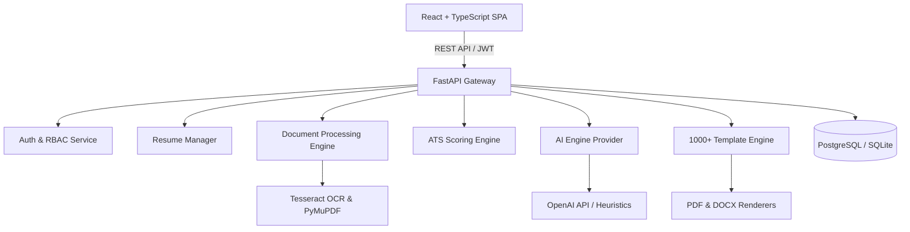

# Platform Architecture & Technical Design

## 1. Modular System Decomposition

The ATS Resume Builder Platform consists of 6 core subsystems:

## 2. ATS Scoring Methodology
The ATS Compatibility Engine scores resumes on a 0-100 scale across 5 weighted categories:
1. **Structural Taxonomy (25%)**: Standard section naming (Experience, Education, Skills, etc.), parseable contact information.
2. **Keyword Relevance & Density (30%)**: Extraction and frequency alignment of hard skills, soft skills, and domain keywords.
3. **Typography & Formatting (15%)**: ATS-safe fonts (Arial, Calibri, Helvetica, Roboto, Times), single-page overflow checks, no unparseable graphic tables.
4. **Quantified Accomplishments (15%)**: Presence of metrics (%, $, numbers, growth percentages) in experience bullets.
5. **Action-Verb Prominence (15%)**: Strong leadership and technical action verbs at the start of bullet points.

## 3. Template Engine Architecture
The system supports over 1,000 distinct template configurations programmatically synthesized through a multi-dimensional matrix:
- **Layout Topologies**: 1-Column Classic, Modern 2-Column (Left Sidebar), Modern 2-Column (Right Sidebar), Executive Minimal, Compact Grid, Timeline Accent.
- **21 Professional Categories**: Software Engineer, Data Analyst, IT, Cybersecurity, Healthcare, Finance, HR, Marketing, Executive, etc.
- **Palette Variations**: Corporate Navy, Emerald Slate, Crimson Bold, Monochromatic Minimal, Cyber Teal, Royal Amethyst, Sunset Amber, etc.
- **Typography Sets**: Modern Sans-Serif, Executive Serif, Clean Hybrid, Technical Monospace.
- **Section Arrangers**: Standard, Skills-First, Experience-First, Project-Centric.
